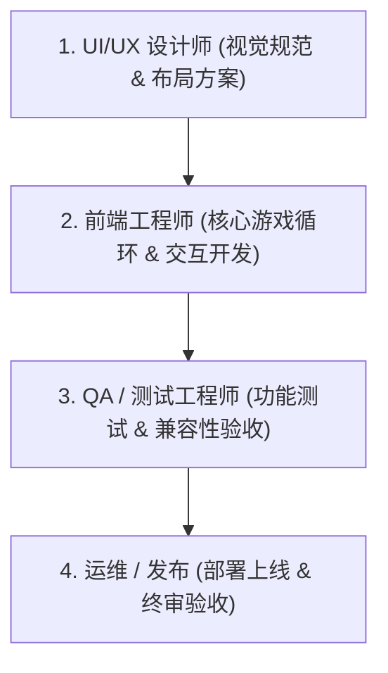

# 贪吃蛇 Web 游戏项目开发计划（PROJECT-PLAN.md）

## 1. 项目背景与目标
- **项目名称**：经典贪吃蛇 Web 游戏 (Snake Classic)
- **工程目录**：`/Users/zwl/orca/projects/demo-1123/`
- **项目目标**：实现开箱即用、支持 PC/移动端自适应与本地数据持久化的经典轻量级贪吃蛇游戏。

---

## 2. 角色分工与执行顺序

| 角色 | 核心职责 | 依赖输入 | 阶段交付物 |
| :--- | :--- | :--- | :--- |
| **UI/UX 设计师** | 视觉风格定义（暗色复古/街机风）、页面排版、网格配色、覆盖层（开始/暂停/结算）及移动端虚拟按键规范 | PRD 需求文档 | 设计样式规范、布局 CSS 规范与素材清单 |
| **前端工程师** | 单页面骨架搭建、Canvas/Grid 游戏引擎实现、输入事件绑定（键盘/手势/虚拟键）、localStorage 存储 | UI 设计规范、PRD | 完整可运行的前端代码（HTML/CSS/JS） |
| **测试工程师 (QA)** | 核心玩法验证、边界碰撞（掉头防误触、撞墙/撞身）、难度倍率校验、移动端多分辨率兼容测试 | 前端交付版本 | 测试用例文档、Bug 追踪记录与验收报告 |
| **运维 / 交付** | 静态页面打包部署、发布验证及上线交付 | QA 验收通过版本 | 生产访问地址、上线验收确认 |

---

## 3. 开发任务拆解（WBS）

### 任务一：UI/UX 设计与布局规划（预计 0.5 天）
- [ ] 设定游戏主题调色盘（经典暗色复古街机风格，高对比度网格与食物高亮）
- [ ] 输出 Header 栏设计（标题、计分板、难度选择、静音开关）
- [ ] 输出 Game Canvas 核心视觉与状态遮罩层（Start / Pause / Game Over）
- [ ] 设计移动端虚拟控制器布局与手势引导说明

### 任务二：前端核心引擎与业务逻辑开发（预计 1.5 天）
- [ ] **基础工程与页面结构**：创建标准单页面结构（index.html / style.css / main.js）。
- [ ] **网格与渲染引擎**：20x20 标准虚拟网格画布渲染，支持蛇身与食物的动态重绘。
- [ ] **游戏核心循环**：基于 `requestAnimationFrame` 或定频定时器的游戏循环与步进机制。
- [ ] **移动与碰撞判定**：蛇身匀速移动、吃食增长、撞墙与撞身 Game Over 判定，防止 180 度反向自杀。
- [ ] **食物机制**：普通红苹果 (+10分) 与限时金色果 (+30分，5秒倒计时) 生成机制。
- [ ] **难度梯度控制**：实现简单 (200ms)、普通 (150ms 递进加速)、困难 (100ms + 静态障碍) 模式。
- [ ] **数据持久化**：使用 `localStorage` 记录历史最高分与 Top 5 本地排行榜。
- [ ] **多端输入适配**：绑定键盘（方向键/WASD/空格）、触摸滑动（Touch Swipe）与虚拟方向键点击。

### 任务三：系统测试与多端调优（预计 0.5 天）
- [ ] **核心游戏逻辑测试**：验证蛇转向响应、碰撞判定边界、特殊果生成与消失倒计时。
- [ ] **反向移动防护测试**：快速连续按键时的转向队列处理，杜绝掉头自杀。
- [ ] **异常与数据测试**：页面刷新后本地最高分保留、异常分辨率适配。
- [ ] **移动端真机/模拟器测试**：虚拟按键灵敏度、触控手势防滚动穿透。

### 任务四：发布部署与最终验收（预计 0.5 天）
- [ ] 静态资源整合与性能检查。
- [ ] 小秘书与产品经理终审验收。

---

## 4. 项目里程碑规划（Milestones）

| 里程碑 | 目标节点 | 达成标准 |
| :--- | :--- | :--- |
| **M1: 设计与规范定稿** | Day 1 上午 | 视觉风格与页面布局规范输出，完成前端技术交底 |
| **M2: 游戏核心引擎就绪** | Day 1 下午 | 蛇身移动、进食、碰撞逻辑跑通，基本玩法闭环 |
| **M3: 完整功能联调完成** | Day 2 中午 | 完成难度分级、特殊果、排行榜持久化及移动端适配 |
| **M4: 测试验收与 Bug 清零** | Day 2 下午 | 测试用例 100% 通过，无阻碍性 Bug，产出测试报告 |
| **M5: 终审与交付上线** | Day 3 上午 | 提交小秘书完成全流程验收并归档 |

---

## 5. 风险评估与应对预案
1. **触控冲突风险**：移动端滑动控制可能触发浏览器默认下拉刷新或滚动。
   - *预案*：在 Canvas 及控制区域严格禁用触摸默认事件 (`touch-action: none` / `e.preventDefault()`)。
2. **高速输入掉头判定风险**：玩家极速连按导致帧间方向重叠自杀。
   - *预案*：引入输入方向缓冲队列（Input Queue），确保单次步进只消费一个合法转向指令。
3. **跨端排版错位风险**：
   - *预案*：严格采用 CSS Flex/Grid 与视口单位，保持 Canvas 固定比例缩放。
